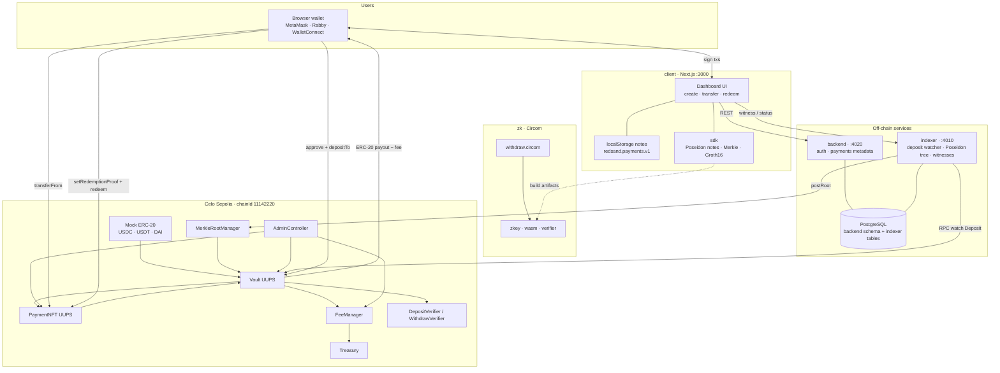
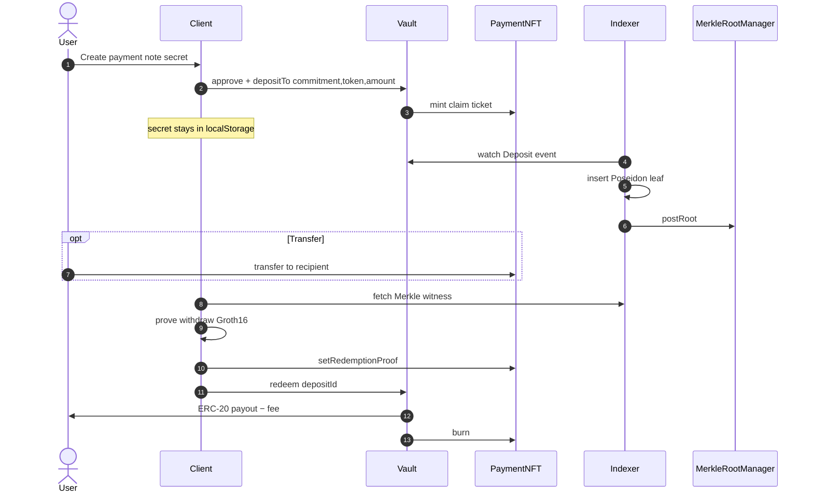

# Redsand

Private payments on **Celo Sepolia** using claim NFTs and zero-knowledge redeem proofs.

Deposit any supported ERC-20 into a vault, mint a **PaymentNFT** as the claim ticket, transfer that NFT to the recipient, then redeem with a Groth16 proof. The vault pays out the locked tokens (minus fee). Secrets stay off-chain; the indexer never sees them.

```
approve(ERC-20) → vault.depositTo → PaymentNFT minted
        → transfer NFT (optional)
        → indexer posts Merkle root
        → stage ZK proof on NFT → vault.redeem → ERC-20 payout
```

---

## Network

| Setting | Value |
|---------|--------|
| Network | Celo Sepolia |
| Hardhat name | `celoSepolia` |
| Chain ID | `11142220` |
| Native gas | CELO (18 decimals) |
| RPC | `https://forno.celo-sepolia.celo-testnet.org/` |
| Explorer | [celo-sepolia.blockscout.com](https://celo-sepolia.blockscout.com) |

There is **no** confidential / FHE token layer on Celo. Tokens are cleartext ERC-20; privacy is via NFT claim ownership + ZK nullifiers.

---

## Monorepo layout

```
red-sand/
├── hardhat-contracts/   # Solidity Vault, PaymentNFT, fees, deploy scripts
├── zk/                  # Circom withdraw circuit + snarkjs keys
├── sdk/                 # Poseidon notes, Merkle, Groth16 proving helpers
├── indexer/             # Deposit watcher, Poseidon tree, postRoot, witness API
├── backend/             # Auth, usernames, payment dashboard metadata
└── client/              # Next.js UI (WalletConnect + create / transfer / redeem)
```

| Package | Role | Default port |
|---------|------|--------------|
| `hardhat-contracts` | On-chain protocol | — |
| `zk` | Circuit build / verifier export | — |
| `sdk` | Shared crypto for client & scripts | — |
| `indexer` | Merkle roots + witnesses | `4010` |
| `backend` | Off-chain API (Postgres) | `4020` |
| `client` | Frontend | `3000` |

Each package has its own `package.json` (pnpm, `--ignore-workspace`).

---

## Platform architecture

High-level view of how the Envelope stack fits together on **Celo Sepolia**. Secrets never leave the client; the indexer only sees public commitments and posts Merkle roots.



### Payment lifecycle



| Layer | Components | Trust notes |
|-------|------------|-------------|
| Wallet / client | Wagmi, note secrets, SDK proofs | Secrets never sent to backend/indexer |
| Backend | JWT auth, payment list, encrypted note blobs | Metadata only — not required for redeem |
| Indexer | Event sync, Poseidon tree, `postRoot`, witness API | Relayer must own `MerkleRootManager` |
| Contracts | Vault, PaymentNFT, roots, fees, admin | Cleartext ERC-20 lock; privacy via NFT + ZK nullifier |
| ZK | Circom withdraw + exported verifier | Deposit needs no circuit |

---

## How it works

### On-chain

1. **Deposit** — User approves the Vault, then calls  
   `depositTo(commitment, token, amount, recipient, noteURI)`.  
   Vault locks ERC-20, stores per-deposit `token` + `amount`, mints a PaymentNFT to `recipient` (or `msg.sender`).
2. **Transfer** — NFT can move with standard ERC-721 transfer; only the current owner can redeem.
3. **Root** — Indexer inserts Poseidon commitments as leaves and calls `MerkleRootManager.postRoot`.
4. **Redeem** — Owner stages a proof on the NFT, then `vault.redeem(depositId)`: verify ZK, burn NFT, pay ERC-20 (− fee).

### ZK (Option B)

- Commitment: `Poseidon([secret, recipientDigest, amount, tokenHash])`
- Nullifier: `Poseidon([secret])`
- Merkle: depth **20**, Poseidon₂, tree **off-chain**
- Public inputs (locked):  
  `[root, nullifier, recipientDigest, amount, tokenHash]`  
  where `tokenHash = uint256(uint160(token))`

Deposit needs **no** circuit. Only redeem does.  
Details: [`zk/PROTOCOL.md`](zk/PROTOCOL.md).

### Off-chain

- **SDK** builds notes and (later) full Groth16 proofs.
- **Indexer** never stores secrets; serves membership witnesses.
- **Backend** stores dashboard metadata (payments, activity, notes ciphertext).
- **Client** keeps note secrets in `localStorage` (`redsand.payments.v1`).

---

## Quick start (local)

Prerequisites: Node 20+, pnpm 9+, PostgreSQL, Circom (for ZK rebuild), a Celo Sepolia key with CELO for gas.

### 1. Contracts

```bash
cd hardhat-contracts
pnpm install --ignore-workspace
cp .env.example .env
# set CELO_SEPOLIA_PRIVATE_KEY=

pnpm compile
pnpm test                    # unit tests (local Hardhat)
pnpm deploy                  # → deployments/celoSepolia.json
pnpm status
```

Useful:

```bash
pnpm mint:all                              # fresh mock USDC/USDT/DAI + enable on Vault
TOKEN_ADDRESS=0x... TOKEN_SYMBOL=FOO pnpm deploy:token   # enable a custom ERC-20
SKIP_TOKEN=1 pnpm deploy                   # core contracts only
```

### 2. ZK + SDK (optional for mock verifier)

Deploy uses a mock `DepositVerifier` (always true) so you can E2E without keys. For real proofs:

```bash
cd zk
pnpm install --ignore-workspace
pnpm build                   # needs circom
pnpm export:verifier         # writes WithdrawVerifier into hardhat-contracts

cd ../sdk
pnpm install --ignore-workspace
pnpm build && pnpm test
```

Then deploy `WithdrawVerifier` and `vault.setVerifier(...)`.

### 3. Indexer

```bash
cd indexer
pnpm install --ignore-workspace
cp .env.example .env
# DATABASE_URL, RELAYER_PRIVATE_KEY (must own MerkleRootManager)
# VAULT_ADDRESS + MERKLE_ROOT_MANAGER_ADDRESS from deployments/celoSepolia.json
# RPC_URL=https://forno.celo-sepolia.celo-testnet.org/
# CHAIN_ID=11142220
# EVENT_SOURCE=rpc

createdb redsand_indexer     # or equivalent
pnpm db:migrate
pnpm dev                     # http://127.0.0.1:4010
```

### 4. Backend

```bash
cd backend
pnpm install --ignore-workspace
cp .env.example .env
# DATABASE_URL (schema "redsand"), JWT_SECRET, CORS_ORIGIN

pnpm db:generate
pnpm db:push
pnpm dev                     # http://127.0.0.1:4020
```

### 5. Client

```bash
cd client
pnpm install --ignore-workspace
cp .env.example .env
# NEXT_PUBLIC_WALLETCONNECT_PROJECT_ID from https://cloud.reown.com

# Addresses live in src/lib/contracts.ts (synced from deployments/celoSepolia.json)

pnpm sdk:build
pnpm dev                     # http://localhost:3000
```

Add Celo Sepolia in your wallet:

- Chain ID: `11142220`
- RPC: `https://forno.celo-sepolia.celo-testnet.org/`
- Symbol: `CELO`
- Explorer: `https://celo-sepolia.blockscout.com`

Faucet: [faucet.celo.org/celo-sepolia](https://faucet.celo.org/celo-sepolia)

---

## User flow (product)

1. Connect wallet on Celo Sepolia.
2. Hold a supported ERC-20 (mocks from `pnpm mint:all`, or a real token enabled via `deploy:token`).
3. **Create payment** — choose token + amount + optional NFT recipient → approve → deposit → PaymentNFT minted.
4. Optionally **transfer** the NFT to another wallet.
5. Wait for indexer to confirm the leaf and post a root.
6. **Redeem** — owner stages mock/real proof → `redeem` → tokens arrive (− protocol fee).

---

## Environment cheat sheet

### hardhat-contracts

| Variable | Purpose |
|----------|---------|
| `CELO_SEPOLIA_PRIVATE_KEY` | Deployer / ops signer |
| `CELO_SEPOLIA_RPC_URL` | Defaults to Forno |
| `BLOCKSCOUT_API_KEY` | Optional verify |
| `USDC_ADDRESS` / … | Optional; mocks deployed by default |
| `TOKEN_ADDRESS` | Enable custom ERC-20 via `deploy:token` |

### indexer

| Variable | Purpose |
|----------|---------|
| `RPC_URL` / `CHAIN_ID` | Celo Sepolia |
| `VAULT_ADDRESS` | From deployment JSON |
| `MERKLE_ROOT_MANAGER_ADDRESS` | From deployment JSON |
| `RELAYER_PRIVATE_KEY` | Root poster (not a user key) |
| `DATABASE_URL` | Postgres |
| `EVENT_SOURCE` | `rpc` or Goldsky |
| `API_PORT` | Default `4010` |

### backend

| Variable | Purpose |
|----------|---------|
| `DATABASE_URL` | Postgres (schema `redsand`) |
| `JWT_SECRET` | Session signing |
| `CORS_ORIGIN` | Frontend origin |
| `PORT` | Default `4020` |

### client

| Variable | Purpose |
|----------|---------|
| `NEXT_PUBLIC_WALLETCONNECT_PROJECT_ID` | Reown / WalletConnect |
| `NEXT_PUBLIC_INDEXER_URL` | Default `http://127.0.0.1:4010` |
| `NEXT_PUBLIC_BACKEND_URL` | Default `http://127.0.0.1:4020` |
| `NEXT_PUBLIC_FRONTEND_URL` | App origin |

Contract addresses are **not** env vars — edit `client/src/lib/contracts.ts` after deploy.

---

## Package docs

| Package | README |
|---------|--------|
| Contracts | [`hardhat-contracts/README.md`](hardhat-contracts/README.md) |
| ZK protocol | [`zk/PROTOCOL.md`](zk/PROTOCOL.md) |
| Indexer | [`indexer/README.md`](indexer/README.md) |
| Backend | [`backend/README.md`](backend/README.md) |
| Client | [`client/README.md`](client/README.md) |

---

## Scripts reference

### Contracts (`hardhat-contracts`)

| Command | Description |
|---------|-------------|
| `pnpm compile` | Compile Solidity |
| `pnpm test` | Unit tests |
| `pnpm deploy` | Full stack → `deployments/celoSepolia.json` |
| `pnpm deploy:token` | Deploy mocks or enable `TOKEN_ADDRESS` |
| `pnpm mint:all` | Mintable mocks + enable on Vault |
| `pnpm status` | On-chain status |
| `pnpm e2e` | Live E2E on Celo Sepolia |
| `pnpm verify:all` | Blockscout verify |

### ZK / SDK

| Command | Description |
|---------|-------------|
| `pnpm --dir zk build` | Compile circuit + ceremony keys |
| `pnpm --dir zk export:verifier` | Emit Solidity verifier |
| `pnpm --dir sdk build` | Build TypeScript SDK |
| `pnpm --dir sdk test` | Crypto unit tests |

### Apps

| Command | Description |
|---------|-------------|
| `pnpm --dir indexer dev` | Indexer API + sync loop |
| `pnpm --dir backend dev` | Backend API |
| `pnpm --dir client dev` | Next.js frontend |

---

## Security notes

- Mock `DepositVerifier` must **never** hold real funds — replace with `WithdrawVerifier` for production.
- Relayer key is for `postRoot` only; never use a user wallet or store note secrets in the indexer.
- Note secrets live in the browser (`localStorage`); clearing storage loses redeem capability for those notes.
- Amount is cleartext on deposit (ERC-20 transfer + event). Claim privacy is NFT ownership + ZK nullifier, not amount encryption.
- Owner emergency paths while paused can drain — use multisig + limits in production.
- Keep `RELAYER_PRIVATE_KEY`, `JWT_SECRET`, and deploy keys out of git.

---

## Deploy checklist

1. [x] Deploy contracts on Celo Sepolia (`pnpm --dir hardhat-contracts deploy`)
2. [ ] Fund deployer + test wallets with CELO
3. [x] Mint / enable tokens (Mock USDC/USDT/DAI from `deploy-all`)
4. [x] Point indexer `.env.example` at deployment addresses + Celo RPC
5. [x] Sync `client/src/lib/contracts.ts` + indexer env from `deployments/celoSepolia.json`
6. [ ] Run indexer + backend + client
7. [ ] Smoke: create payment → wait for root → redeem
8. [ ] (Prod) Build ZK keys, deploy `WithdrawVerifier`, set verifier on Vault

---

## License

Private / unpublished unless otherwise noted in package files.
